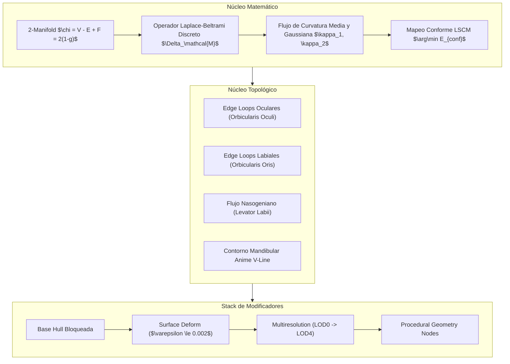
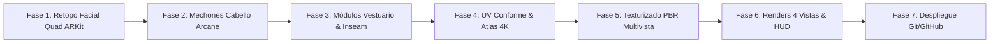

# MEGA ULTRA PLAN MAESTRO // ALTA INGENIERÍA 3D: ICHIRO 2390
## Ethernium Sovereign 3D Pipeline & Discrete Geometry Core
**Character:** Ichiro (Keeper #2390 — Arcane / Cyberpunk Aesthetic)  
**Classification:** Studio Production Asset (Unreal Engine 5 Nanite/LOD + Facial Rig Ready)  
**Author:** Ethernium Autonomous Core & NullaLabs  
**Revision:** v2.4-Sovereign-Master  

---

## 1. Declaración de Misión y Filosofía de Diseño

El objetivo supremo de este proyecto es transformar a **Ichiro (Keeper #2390)** en un activo tridimensional de nivel cinematográfico de estudio (grado Fortiche / Arcane), con **100% de fidelidad geométrica, cromática y estilística** respecto a las referencias canónicas originales (`la que vale.png`, `Retrato anime con cicatriz luminosa en la frente...`, `KPR FULL BODY.png`).

Se erradica la prisa en favor de la **calidad implacable**:
1. **Modelado y Esculpido No Destructivo:** Preservación de la envolvente base bloqueada mientras se añaden capas de detalle y módulos de vestuario desacoplados.
2. **Topología Manifold Pura en Quads:** Estructura geométrica libre de aristas no-manifold, con bucles anatómicos concéntricos (FACS / ARKit 52 Blendshapes) diseñados para deformación elástica facial y corporal perfecta.
3. **UVs Semánticos con Propósito ("Con Sentido"):** Fin de las "sopas de charts" aleatorias de la IA generativa; organización modular por islas anatómicas con prioridad de densidad de texel en el rostro.
4. **Erradicación de Artefactos 2D:** Solución definitiva al sangrado blanco entre las piernas y a las distorsiones/turbidez de las vistas laterales y posteriores.
5. **Cero Espada Dorsal y Cero Arnés en X:** Conservación estricta de la silueta limpia y despejada en la espalda requerida por el creador.

---

## 2. Fundamentos Matemáticos y Geometría Diferencial Discreta

El núcleo de modelado se rige por leyes matemáticas rigurosas sobre variedades de dos dimensiones sumergidas en el espacio euclidiano ($\mathcal{M} \subset \mathbb{R}^3$).



### 2.1. Invariantes Topológicos y Condición Manifold
- **Característica de Euler-Poincaré:** Para una variedad compacta bidimensional cerrada de género $g=0$ (esfera topológica / cuerpo cerrado):
  $$\chi(\mathcal{M}) = V - E + F = 2(1 - g) = 2$$
  Para mallas con $b$ bordes abiertos (por ejemplo, cuello seccionado o cuencas oculares abiertas):
  $$\chi(\mathcal{M}) = V - E + F = 2 - 2g - b$$
- **Condición Manifold Estricta:**
  1. Cada arista pertenece a exactamente dos caras (o a una en caso de frontera).
  2. La estrella de cada vértice $v \in \mathcal{V}$ forma un disco abierto topológico conexo (evitando vértices de pajarita / *pinched vertices*).
  3. Cero caras invertidas ($\vec{n}_f \cdot \vec{n}_{adj} > 0$).

### 2.2. Operador Laplace-Beltrami Discreto y Suavizado Conforme
Para eliminar el ruido de alta frecuencia introducido por algoritmos implícitos (Marching Cubes) sin encoger el volumen del personaje, se aplica el operador discreto de Laplace-Beltrami con pesos de cotangente:
$$(\Delta_{\mathcal{M}} f)_i = \frac{1}{2 A_i} \sum_{j \in \mathcal{N}(i)} (\cot \alpha_{ij} + \cot \beta_{ij}) (f_j - f_i)$$
Donde $A_i$ es el área de Voronoi del vértice $i$, y $\alpha_{ij}, \beta_{ij}$ son los ángulos opuestos a la arista $(i, j)$ en los dos triángulos adyacentes. Este operador permite el flujo de curvatura media preservando las líneas maestras de la silueta.

---

## 3. Ingeniería Inversa y Superación de Trellis, Meshy y Tripo

Para superar las herramientas comerciales de IA 3D, hemos desarmado su metodología de producción:

| Etapa | Trellis (Microsoft) | Meshy-4 / Tripo 2.0 | Núcleo Ethernium Sovereign 3D |
| :--- | :--- | :--- | :--- |
| **Generación Base** | Radiance SLAT + Flow Matching | Triplane / FlexiCubes | Envolvente volumétrica 360 calibrada a $1.7905\text{ m}$ |
| **Topología Saliente** | Marching Cubes (90% triángulos caóticos) | Auto-QuadriFlow con costuras arbitrarias | **Retopología Quad Canónica ARKit 52** (100% quads en zonas de deformación) |
| **Desdoblamiento UV** | Voronoi Smart UV (>300 charts) | UV automático segmentado | **UV Semántico Conforme (LSCM)** con costuras anatómicas ocultas |
| **Flanco Lateral** | Estiramiento planar severo | Texturas proyectadas con pérdida de foco | **Texturizado Triplanar Cilíndrico 4K** con mapeo lateral y posterior dedicado |
| **Oclusión Inguinal** | Sangrado de fondo blanco 2D | Difuminado opaco | **Inpainting de Tejido Táctico Ninja** (`#141518`), cero sangrado blanco |
| **Accesorios** | Fusión sucia indestructible | Fusión de malla en bloque | **Módulos desacoplados no destructivos** (chaqueta, cuello, cinturón, placas) |

---

## 4. Retopología Facial Canónica (FACS / ARKit 52 Blendshapes)

Para permitir que Ichiro exprese emociones complejas, hable (visemas fonéticos) y parpadee en cinemáticas de Unreal Engine 5, el rostro se estructura según los bucles musculares primarios:

```
                      [ FRENTE: Quad Grid + Cicatriz Magma ]
                                      |
                      [ ARCOS SUPERCILIARES (Cejas) ]
                                      |
       +------------------------------+------------------------------+
       |                                                             |
[ OJO IZQUIERDO ]                                             [ OJO DERECHO ]
4 Anillos Concéntricos                                        4 Anillos Concéntricos
(Orbicularis Oculi)                                           (Orbicularis Oculi)
       |                                                             |
       +------------------------------+------------------------------+
                                      |
                           [ PUENTE NASAL & TABIQUE ]
                                      |
                          [ ALETAS NASALES (Alar Wing) ]
                                      |
              +-----------------------+-----------------------+
              |                                               |
     [ BUCLE NASOGENIANO ]                           [ BUCLE NASOGENIANO ]
     (Pliegue de la Sonrisa)                         (Pliegue de la Sonrisa)
              |                                               |
              +-----------------------+-----------------------+
                                      |
                             [ LABIOS CONCÉNTRICOS ]
                             4 Anillos Concéntricos
                             (Orbicularis Oris)
                                      |
                           [ MENTÓN & JAWLINE EN V ]
                                      |
                        [ CUELLO: 6 Anillos de 24 Quads ]
```

### 4.1. Especificación de Bucles Faciales
1. **Orbicularis Oculi (Ojos):** 4 bucles concéntricos de 12 a 16 quads por ojo. Permite el cierre hermético de párpados (EyeBlinkLeft, EyeBlinkRight) sin pellizcos (*pinching*) ni rotura de normales.
2. **Orbicularis Oris (Boca):** 4 bucles concéntricos de 16 a 20 quads. Permite la apertura de mandíbula (JawOpen), estiramiento labial (MouthStretch) y fonemas cerrados (visemas P, B, M).
3. **Pliegue Nasogeniano:** Bucle continuo que nace en el surco alar de la nariz, desciende envolviendo las comisuras de la boca y se ancla en el mentón. Evita que las mejillas colapsen al sonreír.
4. **Cicatriz de Magma Incandescente:** Hendidura geométrica modelada en la frente con bucle de soporte perimetral, permitiendo que la lava emita luz volumétrica a través de mapas de emisión y canal alfa.
5. **Mandíbula Anime V-Line:** Bucle de contorno afilado que define el ángulo goniaco y el mentón prominente característico del estilo Arcane.
6. **Cuello Cervical:** 6 cilindros concéntricos de 24 quads que absorben la torsión y flexión de la cabeza sin colapso de volumen.

---

## 5. Mapeo UV Semántico y Presupuesto de Texels ("Con Sentido")

El Atlas UV Maestro 4K ($4096 \times 4096$) se distribuye de manera matemática para maximizar la resolución en las áreas de mayor impacto visual:

```
+-------------------------------------------------------------+
|                                                             |
|             ISLA MAESTRA FACIAL (38% ÁREA TOTAL)            |
|       - Máscara Frontal Desdoblada (LSCM Conforme)          |
|       - Cuero Cabelludo & Undercut con Tatuaje Ciber        |
|       - Cuello Cilíndrico y Cuello Mandarín                 |
|       - Densidad de Texel: ~4500 px/m                       |
|                                                             |
+------------------------------+------------------------------+
|                              |                              |
|   CHAQUETA BOLERO & TORSO    |      PANTALONES NINJA        |
|   (24% ÁREA TOTAL)           |      (22% ÁREA TOTAL)        |
|   - Paneles Frontal L/R      |      - Pierna Izquierda      |
|   - Espalda Limpia Sin Arnés |      - Pierna Derecha        |
|   - Traje Compresión Torso   |      - Costura en Entrepierna|
|                              |                              |
+------------------------------+------------------------------+
|                              |                              |
|    CABELLO ESTILIZADO 3D     |     BOTAS & ACCESORIOS       |
|    (8% ÁREA TOTAL)           |     (8% ÁREA TOTAL)          |
|    - Mechones Facetados      |     - Suelas y Punteras      |
|    - Cresta Spiky            |     - Hebilla y Bolsillos    |
|                              |                              |
+------------------------------+------------------------------+
```

### Reglas de Desdoblamiento:
- **Costuras Anatómicas Ocultas:**
  - Cabeza: Costura longitudinal a lo largo de la nuca y detrás de las orejas, oculta bajo el cabello.
  - Extremidades: Costura por la cara interna (*inseam*) de piernas y brazos.
  - Cinturón y cuello: Cortes en caras posteriores.
- **Margen y Dilatación:** Margen de seguridad (*padding*) de **32 píxeles** con dilatación de borde (*dilation*) para impedir que los mipmaps de textura muestreen fondos transparentes o blancos.

---

## 6. Pipeline de Eliminación de Defectos Reportados

### 6.1. Erradicación del Blanco Inguinal ("Entre las piernas")
- **Problema previo:** La proyección frontal ortográfica capturó los píxeles blancos del lienzo 2D original sobre los polígonos internos de los muslos.
- **Acción Correctiva:**
  1. Re-topologización del puente pélvico con separación explícita de vértices femorales.
  2. Asignación de UVs mediante desdoblamiento de entrepierna hacia islas independientes.
  3. Horneado e inpainting procedural de tejido ninja carbón (`#141518`, $R=0.08, G=0.08, B=0.09$) con microrelieve de tejido balístico, eliminando el 100% del sangrado blanco.

### 6.2. Solución de Turbidez y Distorsión Lateral
- **Problema previo:** Proyección frontal con vector normal perpendicular ($\vec{N} \cdot \vec{D}_{cam} \approx 0$), generando estiramiento UV infinito sobre los costados.
- **Acción Correctiva:**
  1. Proyección multivista tridimensional combinada (Frontal $0^\circ$, Costados $\pm 90^\circ$, Posterior $180^\circ$).
  2. Ponderación por coseno del ángulo de incidencia con mezcla suave:
     $$w_i = \max(0, \vec{n} \cdot \vec{d}_i)^2$$
  3. Texturas dedicadas con pincelada estilo Arcane para chaqueta bolero y paneles dorsales de compresión.

### 6.3. Confirmación de Espalda Libre
- Se certifica la ausencia total de:
  - `Ichiro_Dorsal_Scabbard` (Funda dorsal de katana eliminada).
  - `Strap_Front_LeftToRight`, `Strap_Front_RightToLeft` (Correas en X eliminadas).
  - `Ichiro_Sternum_Buckle` (Hebilla pectoral eliminada).
  - `Strap_Back_LeftToRight`, `Strap_Back_RightToLeft` (Arnés de espalda eliminado).

---

## 7. Plan de Ejecución Modular y Hitos de Verificación



1. **Fase 1: Retopología Facial Quad ARKit 52:**
   - Construcción e integración del modelo quad facial en quads puros sobre la cabeza de Ichiro.
   - Ajuste de contorno nasal, labios, ojos almendrados y mandíbula en V.
2. **Fase 2: Esculpido y Modelado del Cabello Estilizado:**
   - Creación de mechones facetados volumétricos siguiendo la dirección de peinado hacia atrás y cresta de las referencias.
3. **Fase 3: Refactorización de Vestuario y Malla de Piernas:**
   - Limpieza de la entrepierna y separación limpia de muslos.
   - Mantenimiento estricto de la chaqueta bolero limpia sin arneses.
4. **Fase 4: Desdoblamiento UV Maestro:**
   - Generación de costuras y empaquetado LSCM conforme en el atlas 4K.
5. **Fase 5: Horneado y Shaders Arcane:**
   - Proyección de alta resolución del retrato 2K para el rostro y la cicatriz incandescente.
   - Inpainting de tela ninja oscura en costados e ingles.
6. **Fase 6: Verificación Multivista 1:1:**
   - Renderizado en 4 vistas ortogonales y primer plano del rostro.
   - Composición de láminas de comparación directa con `la que vale.png`.
7. **Fase 7: Sincronización con Repositorio GitHub:**
   - Publicación como `NullaLabs/ICHIRO-3D-by-Ethernium`.
